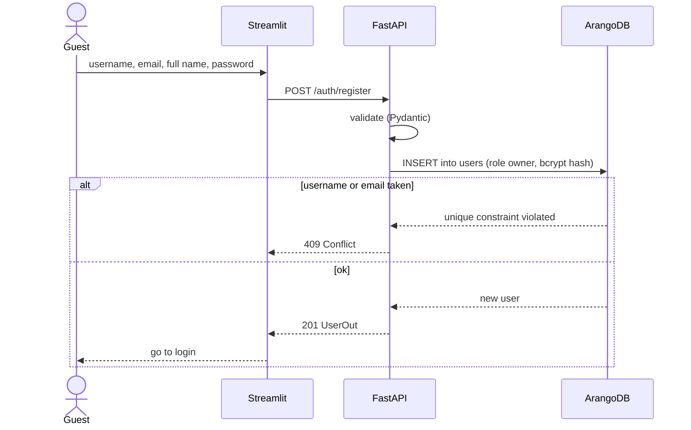
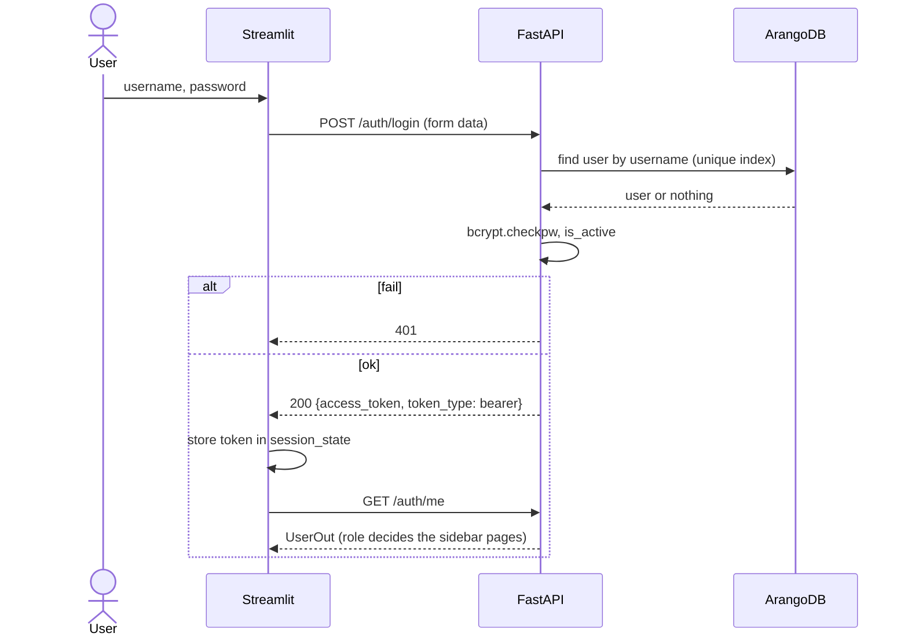
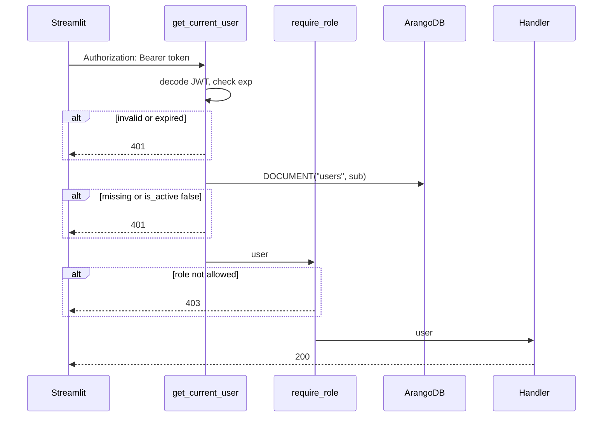

# Authentication

Users log in with a username and password and get a JWT. The token only says who the user is. What the user may do is read from the database on every request.

## Token

| Claim | Value |
| --- | --- |
| `sub` | the user's `_key` |
| `iat` | issue time |
| `exp` | issue time + `JWT_EXPIRE_MINUTES` (default 60) |

Signed with HS256 and `JWT_SECRET`. There is no refresh token. When the token expires the user logs in again.

The role is **not** in the token. That is on purpose, see below.

## Consequences of a stateless token

- The backend keeps no session table. A token is valid until `exp`, and the server cannot revoke it earlier.
- Because of that, every protected request loads the user from `users` and checks `is_active` and `role`. If an admin deactivates a user or changes the role, it takes effect on the next request, even though the old token is still cryptographically valid.
- Logout only deletes the token from `st.session_state` in Streamlit. A copied token keeps working until it expires, but only for an active user and only with the user's current role.
- Changing `JWT_SECRET` invalidates all tokens at once.

## Passwords

- Hashed with bcrypt (cost 12). Only `password_hash` is stored.
- Minimum length 8 characters, checked by Pydantic.
- `password_hash` is never returned. Responses use the `UserOut` model, which does not have that field.
- Login returns the same `401 Invalid username or password` for an unknown user, a wrong password and a deactivated account.

Password reset, email verification and rate limiting are out of scope for this project.

## Registration



Self-registration always creates an `owner`. Only an admin can make someone a `mechanic` or `admin`.

## Login



## Protected request and role check



In code this is two FastAPI dependencies:

```python
@router.post("/services", status_code=201)
def create_service(body: ServiceIn, user: User = Depends(require_role("mechanic"))):
    ...
```

`require_role(*roles)` returns a dependency that calls `get_current_user` and then checks `user.role in roles`.

## Ownership checks

Some rules depend on data, not only on the role. An owner may see a vehicle only if there is an active `owns` edge from the owner to that vehicle. This check is part of the repository query, so it cannot be skipped by calling the API directly:

```aql
FOR v, e IN 1..1 OUTBOUND @user_id owns
  FILTER v.vin == @vin AND e.until == null
  RETURN v
```

A mechanic's workshop comes from the `works_at` edge. When a mechanic creates a service record, the workshop is taken from there, not from the request body.
