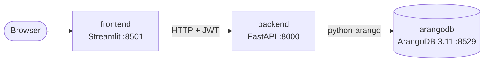
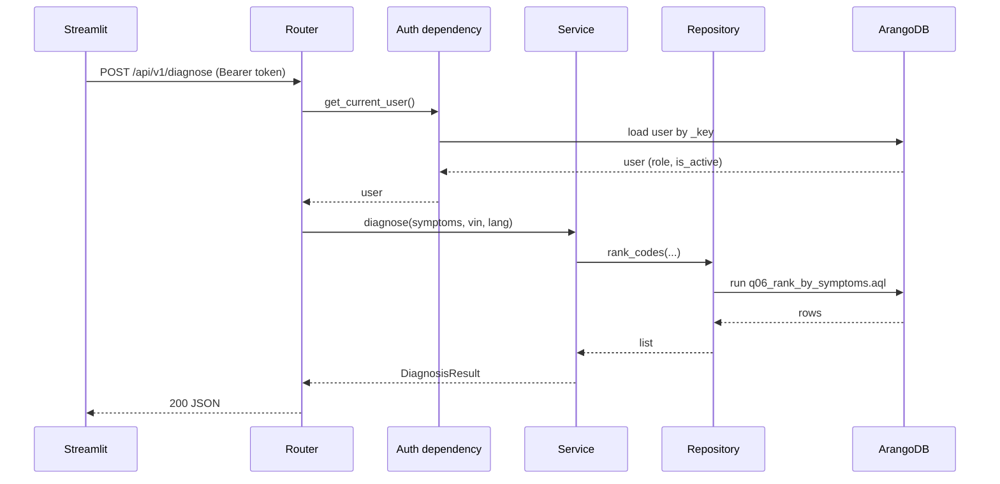

# Architecture overview

Three containers run the application. Streamlit talks to FastAPI over HTTP, and only FastAPI talks to ArangoDB.



## Backend layers

The layering follows what a Spring Boot project would have.

| Layer | Folder | Spring equivalent | Job |
| --- | --- | --- | --- |
| Routers | `app/routers/` | `@RestController` | HTTP, request and response models, role checks |
| Services | `app/services/` | `@Service` | Business rules (mileage check, delete rules, transactions) |
| Repositories | `app/repositories/` | `@Repository` | All database access, runs AQL from `.aql` files |
| Models | `app/models/` | DTOs with Bean Validation | Pydantic schemas |
| Database | `app/db/` | config | Connection, schema creation, seed |

AQL text lives in `app/queries/q01_*.aql` to `q18_*.aql`. The repository loads a file by name and runs it with bind parameters. The same files are shown in Query Lab and quoted in these docs, so the code and the documentation never drift apart.

## Request flow



## Folder structure

```text
auto-diag-kb/
├── docker-compose.yml
├── .env.example
├── mkdocs.yml
├── backend/
│   ├── Dockerfile
│   ├── requirements.txt
│   ├── app/
│   │   ├── main.py
│   │   ├── config.py
│   │   ├── db/            # connection.py, schema.py, seed.py
│   │   ├── models/
│   │   ├── repositories/
│   │   ├── services/
│   │   ├── routers/
│   │   ├── auth/          # jwt.py, passwords.py, deps.py
│   │   └── queries/       # q01_list_dtc.aql ... q18_nearest_workshops.aql
│   └── tests/
├── frontend/
│   ├── Dockerfile
│   ├── requirements.txt
│   ├── Home.py
│   ├── api_client.py
│   ├── i18n/              # en.json, sr.json
│   └── pages/
├── data/seed/             # one JSON file per collection, edges/ subfolder
└── docs/                  # this documentation
```

## Language handling

Text that users read is stored in both languages as `{"en": "...", "sr": "..."}`. `en` is required and `sr` is optional. Queries take a `@lang` bind parameter and return `NOT_NULL(doc.title[@lang], doc.title.en)`, so a missing Serbian text falls back to English. Static UI labels come from `frontend/i18n/en.json` and `sr.json`.
