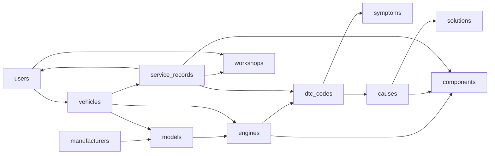
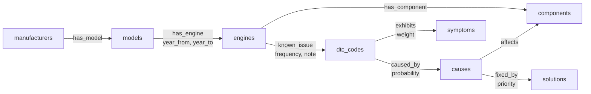
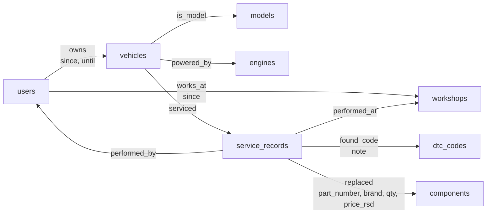

# Graph model

The 17 edge collections are split into two named graphs. `diagnostic_graph` is the knowledge base. `service_graph` is real-world history: users, vehicles, workshops and service records. They share four vertex collections: `models`, `engines`, `dtc_codes` and `components`. Because of that, a query can start at a concrete car and reach the knowledge base in a few hops.

## Overview

Boxes are document collections, arrows are edge collections. Only the connections are shown here; fields are in [Collections](collections.md).

## diagnostic_graph

| Edge | From → To | Attributes | Meaning |
| --- | --- | --- | --- |
| `has_model` | manufacturers → models | | maker produces the model |
| `has_engine` | models → engines | `year_from`, `year_to` | engine offered in the model in those years |
| `has_component` | engines → components | | engine contains the part |
| `known_issue` | engines → dtc_codes | `frequency` (`common`, `occasional`, `rare`), `note` | code is typical for this engine |
| `exhibits` | dtc_codes → symptoms | `weight` 0 to 1 | how strongly the symptom points to the code |
| `caused_by` | dtc_codes → causes | `probability` 0 to 1 | share of cases with this cause; per code the sum is at most 1 |
| `affects` | causes → components | | cause involves the part |
| `fixed_by` | causes → solutions | `priority` (1 = try first) | recommended order of repairs |

Diagnosis enters the graph at `dtc_codes`. Symptoms point in through `exhibits`, and causes, components and solutions lead out.

## service_graph

| Edge | From → To | Attributes | Meaning |
| --- | --- | --- | --- |
| `owns` | users → vehicles | `since`, `until` (null while owned) | ownership; kept after a sale for history |
| `works_at` | users → workshops | `since` | a mechanic's workshop; one active edge per mechanic |
| `is_model` | vehicles → models | | |
| `powered_by` | vehicles → engines | | |
| `serviced` | vehicles → service_records | | |
| `performed_at` | service_records → workshops | | copied from the mechanic's `works_at` when the record is created |
| `performed_by` | service_records → users | | the mechanic who entered the record |
| `found_code` | service_records → dtc_codes | `note` | code read during the visit |
| `replaced` | service_records → components | `part_number`, `brand`, `qty`, `price_rsd` | part replaced during the visit |

`performed_at` is stored even though it can be derived from `performed_by` and `works_at`. If a mechanic later moves to another workshop, old records must still point to the workshop where the work was done.

## Rules the database does not enforce

ArangoDB checks that edge endpoints belong to the allowed vertex collections of a named graph. Everything else is checked in the service layer or the seed loader:

- `caused_by` probabilities per code add up to at most 1.
- A vehicle has exactly one `owns` edge with `until == null`.
- A mechanic has at most one `works_at` edge.
- A new service record's `mileage_km` is not lower than the vehicle's previous record.
