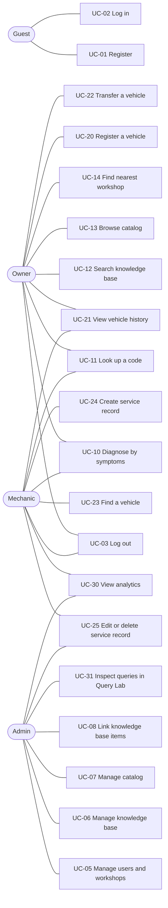

# Actors and use cases

## Actors

| Actor | Who | How they get the role |
| --- | --- | --- |
| Guest | not logged in | |
| Owner | car owner | self-registration |
| Mechanic | works at one workshop | admin changes the role and assigns a workshop |
| Admin | maintains the knowledge base and users | created from `.env` or promoted by another admin |

Owner, Mechanic and Admin are all logged-in users and share the "any user" use cases (UC-03, UC-04, UC-10 to UC-14).

## Overview

Admin can also use UC-10 to UC-14 and UC-20 to UC-23; those lines are left out to keep the picture readable. The exact rules are in [Permissions](permissions.md).

## Use case list

| ID | Name | Actor | File |
| --- | --- | --- | --- |
| UC-01 | Register | Guest | [Authentication](auth.md) |
| UC-02 | Log in | Guest | [Authentication](auth.md) |
| UC-03 | Log out | any user | [Authentication](auth.md) |
| UC-04 | Switch language | any user | [Authentication](auth.md) |
| UC-05 | Manage users and workshops | Admin | [Authentication](auth.md) |
| UC-06 | Manage knowledge base | Admin | [Knowledge base](knowledge-base.md) |
| UC-07 | Manage catalog | Admin | [Knowledge base](knowledge-base.md) |
| UC-08 | Link knowledge base items | Admin | [Knowledge base](knowledge-base.md) |
| UC-10 | Diagnose by symptoms | any user | [Diagnosis](diagnosis.md) |
| UC-11 | Look up a code | any user | [Diagnosis](diagnosis.md) |
| UC-12 | Search knowledge base | any user | [Diagnosis](diagnosis.md) |
| UC-13 | Browse catalog | any user | [Diagnosis](diagnosis.md) |
| UC-14 | Find nearest workshop | any user | [Diagnosis](diagnosis.md) |
| UC-20 | Register a vehicle | Owner, Admin | [Vehicles and services](vehicles-services.md) |
| UC-21 | View vehicle history | Owner of the car, Mechanic, Admin | [Vehicles and services](vehicles-services.md) |
| UC-22 | Transfer a vehicle | Owner of the car, Admin | [Vehicles and services](vehicles-services.md) |
| UC-23 | Find a vehicle | Mechanic, Admin | [Vehicles and services](vehicles-services.md) |
| UC-24 | Create service record | Mechanic | [Vehicles and services](vehicles-services.md) |
| UC-25 | Edit or delete service record | Mechanic (own), Admin | [Vehicles and services](vehicles-services.md) |
| UC-30 | View analytics | Mechanic, Admin | [Analytics](analytics.md) |
| UC-31 | Inspect queries in Query Lab | Admin | [Analytics](analytics.md) |

## Template

Each use case has: ID and name, actor, precondition, main flow, exceptions, and "Realized by" with the endpoint and the query from the [catalog](../queries/overview.md).
